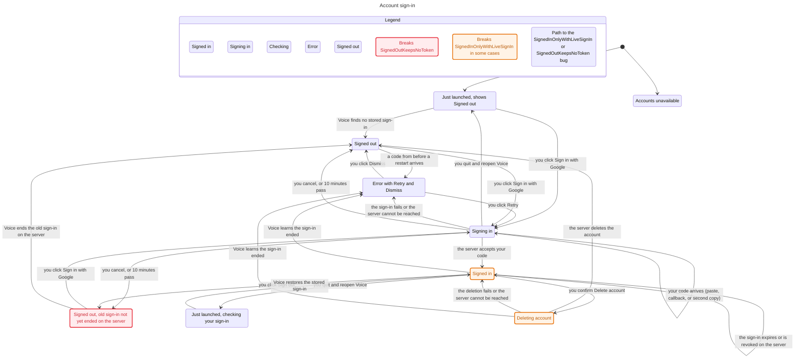

# Account sign-in

This chart follows Settings > Account through Sign in with Google, the pasted code or callback URL (a second copy of Voice hands its URL to the running one), cancel, the 10-minute timeout, sign-in errors, a relaunch, a sign-in that expires or is revoked on the server, sign out, account deletion, and the unavailable build. [The Account feature map](../features/account.md) says how to drive each step.

## Rules

- `SignedInOnlyWithStoredSignIn` holds. The page shows Signed in or Deleting account only while an auth session is stored.
- `SignedInOnlyWithLiveSignIn` breaks in Signed in and Deleting account. The page should show signed in only while the server still accepts the stored auth session.
- `LaunchShowsSignedOutOnlyWithoutStoredSignIn` holds. A launch with an auth session stored reads "Checking your sign-in" with no Sign in button until restore runs, so no click can retire the stored sign-in.
- `SignedOutOnlyWithoutStoredSignIn` holds. Once restore has run, Signed out means no auth session is stored. This covers cancel, the timeout, Dismiss, sign out, and a deleted account.
- `SignedOutKeepsNoToken` breaks in "Signed out, old sign-in not yet ended on the server". Sign out and cancel should leave no token on disk, but the token stays encrypted in `retired_auth_sessions` until the server confirms the old sign-in ended.
- `EndedSignInLeavesNothingStored` holds. An error, the expired or revoked message included, leaves no auth session stored, so Dismiss reaches a clean Signed out and Retry starts a fresh sign-in.
- `ErrorOffersRetryAndDismiss` holds. Every error offers both buttons, so no error is a dead end.
- `CancelReturnsToSignedOut` holds. Cancel works in both sign-in phases (waiting for the browser and redeeming the code) and lands on Signed out with no auth session stored.
- `OfflineNeverSignsOut` holds (a PROPERTY, so the chart does not mark it). While offline with an auth session stored, the page leaves Signed in, Deleting account, or "Just launched, checking your sign-in" only when you click Sign out or Sign in with Google.
- `NoStuckSigningIn` holds (a PROPERTY). With the sign-in timer running, Signing in always ends.

## The `SignedInOnlyWithLiveSignIn` break

0. Just launched, shows Signed out
1. you click Sign in with Google: Signing in
2. your code arrives (paste, callback, or second copy): Signing in
3. the server accepts your code: Signed in
4. the sign-in expires or is revoked on the server: Signed in

Voice cannot see a server-side revocation until it asks. It asks at launch, when the hub gets focus at most once an hour, on a name save, and before a deletion. Until then the page stays Signed in, and while offline it stays Signed in indefinitely. This is the cost of `OfflineNeverSignsOut`. To verify, follow the Expired or revoked recipe. Focus within the check interval leaves the page signed in, and focus after it lands on "Your sign-in expired or was revoked."

## The `SignedOutKeepsNoToken` break

0. Just launched, shows Signed out
1. you click Sign in with Google: Signing in
2. your code arrives (paste, callback, or second copy): Signing in
3. you cancel, or 10 minutes pass: Signed out, old sign-in not yet ended on the server

If the server already set a session cookie when you cancel, Voice queues it for a server sign-out. Nothing drains the queue until the next launch, sign-in, or sign-out. Sign out while offline reaches the same state through "you click Sign out". The queued token never signs Voice back in. To verify, follow the Offline sign-out recipe and check `retired_auth_sessions` before and after the next launch.

## What the model leaves out

- The deletion confirmation dialog and its Cancel, the stale-session Sign in again flow, revoking the older session, and deleting while signed in as a different account. The model folds each into "the deletion fails".
- A stored auth session with no cached identity, from older builds or with safeStorage unavailable, and a restore whose auth client fails to load. Restore then reads Signed out until the server answers, and offline it stays Signed out.
- Malformed and stale codes, which leave the attempt waiting with an alert, and a second code while one is redeemed.
- Name edits, except a save the server answers with 401, which counts as "Voice learns the sign-in ended".
- Quitting while a code is redeemed or a deletion runs, a sign-in blocked by "Voice is restarting", and how a callback brings the hub forward.
- The hourly limit on checks. The model lets a check happen at any time.
- A session the server created whose response never reached Voice.

## What the chart hides

- "you quit and reopen Voice" from both Just launched states, Signed out, the old sign-in state, and the error.
- "a code from before a restart arrives" on Just launched and on the old sign-in state. Both lead to the error, as from Signed out.
- Restore, Dismiss, and a deleted account landing on "Signed out, old sign-in not yet ended on the server" while an older token is still queued.
- Steps that stay in one chart state: the network dropping or returning, a queued sign-out that fails or succeeds while another page shows, and a code arriving while Signing in (drawn only on a bug path).

## Regenerate

Run the sync check in [README.md](README.md#keep-the-charts-true).
