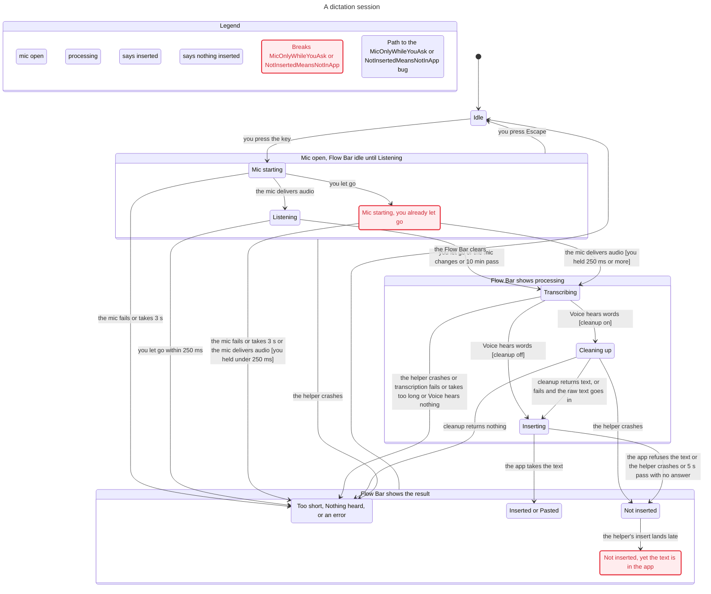

# Dictation session

This chart follows one dictation session from the key press to the result on the Flow Bar, as main's session reducer (`apps/desktop/src/main/session.ts`) runs it together with the helper's capture and insertion. "You let go" also means the second tap of the toggle key, and "you press Escape" also covers another key pressed while you hold the hold key. [The Dictation feature map](../features/dictation.md) says how to drive each step.

The Flow Bar's `data-view` is `idle` while the mic starts, `listening` in Listening, and `processing` while Voice transcribes, cleans up, or inserts. After 30 s of transcribing, or 60 s while the speech model loads, it reads "Still transcribing". Inserted or Pasted shows `inserted`, and "Pasted" after a paste. Every other result shows `message`. After a focus change, Not inserted reads "Not inserted. Focus changed" with Copy to clipboard off, or "Focus changed. Copied to clipboard" once the copy worked. The last result reads "Too short. Hold to talk", "Nothing heard", or an error such as "Voice helper stopped".

## Rules

- `MicOnlyWhileYouAsk` breaks. The microphone is open only while you hold the key, or between your two taps, and Escape closes it.
- `ListeningMeansRecording` holds. The Flow Bar shows listening only while the microphone records.
- `InsertedMeansInApp` holds. The Flow Bar and history say inserted only after the helper reports that the text reached the app.
- `NotInsertedMeansNotInApp` breaks. The Flow Bar and history say not inserted only when the text is not in the app.
- `TranscriptKept` holds. A final transcript with words always ends up in the app, on the clipboard, or in history. A failed cleanup inserts the raw text. A failed insert, a helper crash, or a cleanup that returns nothing keeps the transcript in history as `notInserted`.

## The `MicOnlyWhileYouAsk` break

0. Idle
1. you press the key: Mic starting
2. you let go: Mic starting, you already let go

When you let go before the mic delivers its first audio, main notes the release and sends the helper nothing. The helper keeps the mic open until audio arrives and records it. Only then does main send `capture.stop`, or `capture.cancel` if you held under 250 ms. So the helper transcribes audio from after your release. A mic that never delivers stays open until the 3 s start watchdog sends `capture.cancel`. The Flow Bar shows `idle` the whole time. The code does this on purpose, as the test "release before capture.started stops as soon as capture starts" in `session.test.ts` shows. The open question is whether that overrun is acceptable.

To check it, press, release at 400 ms, and send `capture.started` at 1500 ms through `createDictation`. Main sends `capture.start` at 0 ms and `capture.stop` at 1500 ms, with nothing at the release. Without `capture.started`, main sends `capture.cancel` at 3000 ms.

## The `NotInsertedMeansNotInApp` break

0. Idle
1. you press the key: Mic starting
2. the mic delivers audio: Listening
3. you let go: Transcribing
4. Voice hears words [cleanup off]: Inserting
5. 5 s pass with no answer: Not inserted
6. the helper's insert lands late: Not inserted, yet the text is in the app

After 5 s with no `insert.result`, main ends the session `notInserted`, settles history to `notInserted`, and copies the text when Copy to clipboard is on. No command stops the helper's insert. When the helper's write lands later, main logs `insert.result <id> late phase=done` and changes nothing else. The Flow Bar reads "Not inserted. Copy it from Voice" while the text is in the app, so a paste from the clipboard adds a second copy. The helper inserts on its main thread with a 0.3 s timeout on each accessibility call, so a slow target app can delay the answer.

To check it, drive a session through `createDictation` to `insert`, advance 5 s, and send `insert.result` with method `accessibility`. The pill still reads "Not inserted. Copy it from Voice", and the history entry stays `notInserted`.

## What the model leaves out

- Hold and toggle as separate modes. When the helper ends a toggle capture on its own, through a mic change, the 10 minute cap, or a crash, a tap you meant as stop does nothing while Voice processes and starts a new session once the result shows.
- The speech model missing, failed, or downloading. A press then ends at once with a message and opens no mic.
- Delays between main and the helper. Each command and each event is one step, except an insert. A transcript that arrives after main gave up goes into history as `notInserted`, which the model cannot reach.
- "Still transcribing". The model folds it into Transcribing, and Voice gives up at least 30 s later.
- The clipboard copy after a failed insert. The code waits up to 2 s for it in a phase that shows `processing`. The model makes it part of the failure step.
- Whether the app really took the text. The model trusts the helper's report, and a paste counts once Cmd+V is posted.
- A crash after the helper inserted but before it reported. That also shows Not inserted with the text in the app.
- A late insert after the Flow Bar clears or a new session starts. The model forgets it, and history keeps `notInserted`.
- Snippets, the dictionary, auto-apply transforms, which take the cleanup path, styles, targets, history retention, the transform shortcut, meetings, and quitting the app.

## What the chart hides

The chart hides "you press the key" while the Flow Bar shows a result. It starts a new session the same way as from Idle. The chart also draws no arrow for a release after the helper already stopped capture, or for a late insert that fails, because neither changes what the Flow Bar shows.

## Regenerate

Run the sync check in [README.md](README.md#keep-the-charts-true).
