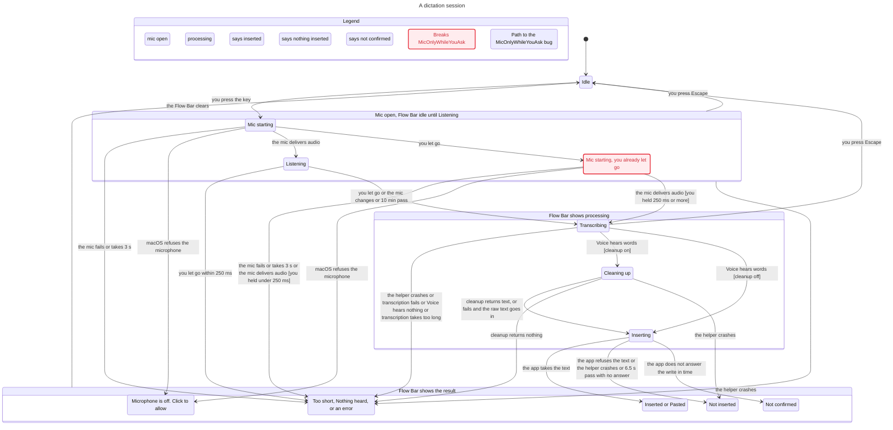

# Dictation session

This chart follows one dictation session from the key press to the result on the Flow Bar, as main's session reducer (`apps/desktop/src/main/session.ts`) runs it together with the helper's capture and insertion. "You let go" also means the second tap of the toggle key, and "you press Escape" also covers another key pressed while you hold the hold key. [The Dictation feature map](../features/dictation.md) says how to drive each step.

The Flow Bar's `data-view` is `idle` while the mic starts, `listening` in Listening, and `processing` while Voice transcribes, cleans up, or inserts. After 30 s of transcribing, or 60 s while the speech model loads, it reads "Still transcribing". Escape in Transcribing, "Still transcribing" included, discards the session as it does in Listening. Inserted or Pasted shows `inserted`, and "Pasted" after a paste. When macOS refuses the microphone, the Flow Bar shows `allow`, a button that reads "Microphone is off. Click to allow", for 6 s instead of 2.5 s. A click shows the system prompt, or the Privacy & Security › Microphone pane once you have said no. Every other result shows `message`. After a focus change, Not inserted reads "Not inserted. Focus changed" with Copy to clipboard off, or "Focus changed. Copied to clipboard" once the copy worked. Not confirmed reads "Not confirmed. Check the app" with Copy to clipboard off, or "Not confirmed. Check before pasting" with it on. The last result reads "Too short. Hold to talk", "Nothing heard", or an error such as "Voice helper stopped".

## Rules

- `MicOnlyWhileYouAsk` breaks. The microphone is open only while you hold the key, or between your two taps, and Escape closes it.
- `ListeningMeansRecording` holds. The Flow Bar shows listening only while the microphone records.
- `InsertedMeansInApp` holds. The Flow Bar and history say inserted only after the helper reports that the text reached the app.
- `NotInsertedMeansNotInApp` holds. The Flow Bar and history say not inserted only when the text is not in the app. The helper starts no write later than 4 s after it received the insert, and main waits 6.5 s before it says not inserted. A write that the app does not answer in time says Not confirmed instead.
- `TranscriptKept` holds. A final transcript with words always ends up in the app, on the clipboard, or in history. A failed cleanup inserts the raw text. A failed insert, a helper crash, or a cleanup that returns nothing keeps the transcript in history as `notInserted`. A write the app does not answer in time keeps it as `unconfirmed`. A transcript that arrives after Voice stopped waiting goes into history as `notInserted`, as [Giving up on a transcription](#giving-up-on-a-transcription) says.

## The `MicOnlyWhileYouAsk` break

0. Idle
1. you press the key: Mic starting
2. you let go: Mic starting, you already let go

When you let go before the mic delivers its first audio, main notes the release and sends the helper nothing. The helper keeps the mic open until audio arrives and records it. Only then does main send `capture.stop`, or `capture.cancel` if you held under 250 ms. So the helper transcribes audio from after your release. A mic that never delivers stays open until the 3 s start watchdog sends `capture.cancel`. The Flow Bar shows `idle` the whole time. The code does this on purpose, as the test "release before capture.started stops as soon as capture starts" in `session.test.ts` shows. The open question is whether that overrun is acceptable.

To check it, press, release at 400 ms, and send `capture.started` at 1500 ms through `createDictation`. Main sends `capture.start` at 0 ms and `capture.stop` at 1500 ms, with nothing at the release. Without `capture.started`, main sends `capture.cancel` at 3000 ms.

## The insert deadline (`NotInsertedMeansNotInApp`)

0. Idle
1. you press the key: Mic starting
2. the mic delivers audio: Listening
3. you let go: Transcribing
4. Voice hears words [cleanup off]: Inserting
5. 6.5 s pass with no answer: Not inserted

After 6.5 s (`INSERT_TIMEOUT_MS`) with no `insert.result`, main ends the session `notInserted`, settles history to `notInserted`, and copies the text when Copy to clipboard is on. No command stops the helper's insert, so the helper holds a deadline of its own. It starts no write later than 4 s after it read the `insert` line (`InsertDeadline`), and it asks right before the accessibility write and right before the paste's clipboard write and Cmd+V. An insert that ran out of time writes nothing and answers `insert.result` with method `none` and reason `failed`. A slow target app, which can use up a 0.3 s timeout on each accessibility call before the write, or a slow clipboard save therefore ends as a true Not inserted.

A write that starts just before the deadline still has to answer before main gives up. The slowest answer is an accessibility write, the read after it, a 50 ms wait, and one re-read, 6.15 s after the helper read the line. `test-fixtures/helper-protocol.json` pins that bound as `insertMaxMs`, and main waits longer. The 350 ms between the two numbers covers the pipe in both directions and a busy helper main thread at the re-read.

To check it, run `swift test --package-path native/voice-helper --filter "PasteKeystrokeTests|AccessibilityWriteTests|InsertDeadlineTests|InsertBudgetTests"` and the test "main waits for an insert longer than the helper can take to answer" in `apps/desktop/src/main/protocol.test.ts`.

## Not confirmed

0. Idle
1. you press the key: Mic starting
2. the mic delivers audio: Listening
3. you let go: Transcribing
4. Voice hears words [cleanup off]: Inserting
5. the app does not answer the write in time: Not confirmed

The accessibility write has a 0.3 s timeout. When it runs out and nothing shows the text landed, the request was still sent, and a busy app can apply it later or never. The helper answers `insert.result` with method `none` and reason `unconfirmed`. Main ends the session `notInserted` with that reason, settles history to `unconfirmed`, and copies the text when Copy to clipboard is on. The hub row shows a "Not confirmed" badge with Copy. The text may be in the app now, later, or not at all, so the Flow Bar asks you to check the app. A refused write and a write past the insert deadline still answer their own reasons and mean the text is not in the app.

To check it, run `swift test --package-path native/voice-helper --filter "AccessibilityWriteTests|ProtocolTests"` and `pnpm --filter @voice/desktop exec vp test run src/main/dictation.test.ts src/renderer/pillView.test.ts src/renderer/History.test.tsx`.

## Microphone refused

0. Idle
1. you press the key: Mic starting
2. macOS refuses the microphone: Microphone is off. Click to allow

The helper answers `capture.failed` with reason `permission`. Main ends the session `permissionMissing` rather than `failed`, keeps the Flow Bar up for 6 s (`IDLE_AFTER_PERMISSION_MS`), and asks the helper for permissions again so the tray's Allow item appears even with the Voice window hidden. Any other reason, or one this build does not know, still ends `failed` with the helper's message.

To check it, run `pnpm --filter @voice/desktop exec vp test run src/main/session.test.ts src/main/dictation.test.ts src/renderer/pillView.test.ts src/renderer/PillCapsule.test.tsx`, and drive it live as [the Permissions feature map](../features/permissions.md) says.

## Giving up on a transcription

0. Idle
1. you press the key: Mic starting
2. the mic delivers audio: Listening
3. you let go: Transcribing
4. transcription takes too long: Too short, Nothing heard, or an error

The first `timedOut` in Transcribing marks the transcription overdue, and the Flow Bar reads "Still transcribing". The second ends the session `failed` with "Transcription did not finish" and sends `capture.detach`, not `capture.cancel`, so the helper keeps transcribing. Main is free at once, and a new press starts a new session. When the late transcript arrives, main saves it to history as `notInserted`, inserts nothing, and leaves the current session alone. A late transcript with no words or a late `transcript.failed` leaves no entry. A helper crash before it arrives loses it. The model holds this in `lateTranscript`, which a new session does not reset.

To check it, run `pnpm --filter @voice/desktop exec vp test run src/main/session.test.ts src/main/dictation.test.ts`, and drive it live with `vv dictate short.wav --key=toggle --asr-delay=75000` as [the Dictation feature map](../features/dictation.md#driving-it-with-voice-verify) says.

## What the model leaves out

- Hold and toggle as separate modes. When the helper ends a toggle capture on its own, through a mic change, the 10 minute cap, or a crash, a tap you meant as stop does nothing while Voice processes and starts a new session once the result shows.
- The speech model missing, failed, or downloading. A press then ends at once with a message and opens no mic.
- Delays between main and the helper. Each command and each event is one step, except an insert and a transcription main gave up on. So the model never has a transcript in flight when you press Escape in Transcribing. In the code, a transcript the helper sent before `capture.cancel` reached it arrives after main went idle, and main keeps it in history as `notInserted`.
- "Still transcribing". The model folds it into Transcribing. Escape works the same in both, and Voice gives up at least 30 s later.
- The clipboard copy after a failed insert. The code waits up to 2 s for it in a phase that shows `processing`. The model makes it part of the failure step.
- Whether the app really took the text. The model trusts the helper's report, and a paste counts once Cmd+V is posted. An accessibility write that the app does not answer in time shows Not confirmed. The model decides at that answer whether the text is in the app, though the app can apply it later.
- Time. The model takes from the insert deadline that main gives up only after the helper can no longer write.
- A crash after the helper inserted but before it reported. That also shows Not inserted with the text in the app.
- A late refusal after the Flow Bar clears or a new session starts. The model forgets it, and history keeps `notInserted`.
- Snippets, the dictionary, auto-apply transforms, which take the cleanup path, styles, targets, history retention, the transform shortcut, meetings, and quitting the app.

## What the chart hides

The chart hides "you press the key" while the Flow Bar shows a result. It starts a new session the same way as from Idle. The chart also draws no arrow for a release after the helper already stopped capture, a late insert that fails, a late transcript that goes into history, or a helper crash while Idle or showing a result, because none of them changes what the Flow Bar shows.

## Regenerate

Run the sync check in [README.md](README.md#keep-the-charts-true).
