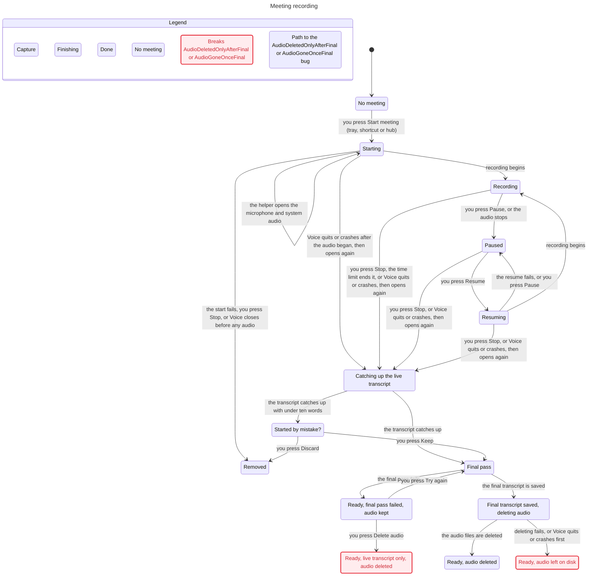

# Meeting recording

This chart follows one meeting from Start meeting (the tray item, the meeting shortcut or the hub's button) to its final transcript. It covers recording the microphone and system audio, pause and resume, Stop or the time limit, the live transcript catching up, `Started by mistake?`, the final pass, deleting the audio, and a quit or crash at any point followed by the next launch. [The Meetings feature map](../features/meetings.md) says how to drive each step.

## Rules

- `RecordsOnlyWhenAsked` holds. The helper records only after you press Start meeting or Resume, and not after you stop or pause. A relaunch never records. It finishes an unfinished meeting from its files and sends no `meeting.start`.
- `TrayStopExactlyWhileLive` holds. The tray item reads "Stop meeting" exactly while a meeting is recording or paused. It also reads "Stop meeting" while paused, because Stop then ends the paused meeting (`meetingToggle` in `shared/meetings.ts`). While a meeting starts or resumes, it reads "Starting meeting…" and does nothing.
- `TrayNeverOffersStartWhileRecording` holds. While the helper records, the tray never offers Start meeting.
- `RecordingMeansCapturing` holds. A meeting reads Recording only while the helper records.
- `AudioDeletedOnlyAfterFinal` breaks, by design. Audio is deleted only after its final transcript is saved, except when you press Delete audio on the "final pass failed" notice. That keeps the live transcript only.
- `VoiceKeepsUnfinishedAudio` holds. A quit, a crash, a relaunch or a failure never throws away audio that has no final transcript. The helper only appends to `mic.pcm` and `system.pcm`, and a relaunch removes a meeting only when its files hold no audio.
- `AudioGoneOnceFinal` breaks. This is a bug. Once the final transcript is saved, the audio should leave the disk.

## The `AudioDeletedOnlyAfterFinal` break

0. No meeting
1. you press Start meeting (tray, shortcut or hub): Starting
2. the helper opens the microphone and system audio: Starting
3. Voice quits or crashes after the audio began, then opens again: Catching up the live transcript
4. the transcript catches up: Final pass
5. the final pass fails: Ready, final pass failed, audio kept
6. you press Delete audio: Ready, live transcript only, audio deleted

The notice offers Try again and Delete audio. Delete audio removes `mic.pcm`, `system.pcm`, `output.ndjson` and `audio.json` and keeps the live transcript. `meeting-recorder.test.ts` checks this in "a failed final pass can be tried again, or its audio deleted, after a relaunch too".

## The `AudioGoneOnceFinal` break

0. No meeting
1. you press Start meeting (tray, shortcut or hub): Starting
2. the helper opens the microphone and system audio: Starting
3. Voice quits or crashes after the audio began, then opens again: Catching up the live transcript
4. the transcript catches up: Final pass
5. the final transcript is saved: Final transcript saved, deleting audio
6. deleting fails, or Voice quits or crashes first: Ready, audio left on disk

Steps 1 to 4 are only the shortest way in. A plain Start, Recording, Stop reaches step 5 too. On `finalized`, main writes `meeting.json` as `ready` with `finalPassFailed: null`, and then it deletes the audio files. If `rm` throws, `runOrFail` only logs it. If Voice quits or crashes between the two, nothing deletes them on the next launch, because `recover()` skips meetings that are `ready`. Delete audio is refused with "There is no kept audio to delete.", and Try again is refused too. With the default retention, "forever", the audio stays on disk for good. Both causes were replayed on the real recorder and store, for this path and for the plain Stop path, with `rm` made to fail and to never return.

## What the model leaves out

- The summary and the title after the final pass, and resuming a meeting that is ready or writing its summary.
- Deleting a meeting from the list, retention expiry, and Discard sent by the API outside `Started by mistake?`.
- The silence prompt. Its 30 s stop is part of "the time limit ends it".
- A meeting that records the microphone only, because system audio is denied or unavailable.
- The echo gate and the voice detector. They decide which words reach the transcript, not which state the meeting is in. The `vv meeting` fixtures check them.
- The helper exit count. A drain or a final pass that loses the helper twice moves on or fails.
- A `meeting.started` that arrives after you paused. Main answers with `meeting.stop`.
- A start watchdog that fires while the helper already writes audio. The meeting is removed with its folder.
- Power loss. The helper syncs the files every 5 s, so the last seconds can go.
- Dictation markers, the notepad, the Flow Bar, and a second meeting. Only one meeting can be live.
- The model treats a quit, the next launch and `recover()` as one step. Start, Resume and the toggle wait behind `recover()`.

## What the chart hides

- A quit or crash in `Started by mistake?` or in Final pass. Both lead to "Catching up the live transcript", as from Paused.
- A quit or crash while catching up. It stays in "Catching up the live transcript".

## Regenerate

Run the sync check in [README.md](README.md#keep-the-charts-true).
