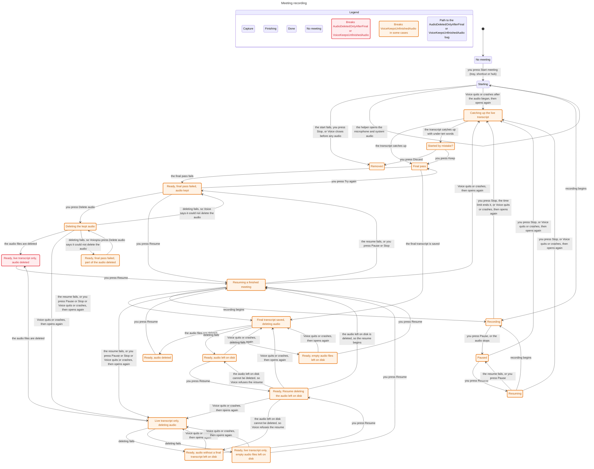

# Meeting recording

This chart follows one meeting from Start meeting (the tray item, the meeting shortcut or the hub's button) to its final transcript. It covers recording the microphone and system audio, pause and resume, Stop or the time limit, the live transcript catching up, `Started by mistake?`, the final pass, deleting the audio, resuming a finished meeting, and a quit or crash at any point followed by the next launch. [The Meetings feature map](../features/meetings.md) says how to drive each step.

## Rules

- `RecordsOnlyWhenAsked` holds. The helper records only after you press Start meeting or Resume, and not after you stop or pause. A relaunch never records. It finishes an unfinished meeting from its files and sends no `meeting.start`.
- `TrayStopExactlyWhileLive` holds. The tray item reads "Stop meeting" exactly while a meeting is recording or paused. It also reads "Stop meeting" while paused, because Stop then ends the paused meeting (`meetingToggle` in `shared/meetings.ts`). While a meeting starts or resumes, it reads "Starting meeting…" and does nothing.
- `TrayNeverOffersStartWhileRecording` holds. While the helper records, the tray never offers Start meeting.
- `RecordingMeansCapturing` holds. A meeting reads Recording only while the helper records.
- `AudioDeletedOnlyAfterFinal` breaks, by design. Audio is deleted only after its final transcript is saved, except when you press Delete audio on the "final pass failed" notice. That keeps the live transcript only.
- `VoiceKeepsUnfinishedAudio` breaks, by design. A quit, a crash, a relaunch or a failure never throws away audio that has no final transcript, except the audio of a cancelled resume. Voice deletes audio without a final transcript otherwise only after you press Delete audio, also when a relaunch finishes that delete. The helper only appends to `mic.pcm` and `system.pcm`, and a relaunch removes a meeting only when its files hold no audio.
- `AudioGoneOnceFinal` holds. Once the final transcript is saved, the next launch deletes any audio file still on disk, also an empty one. A meeting keeps audio files after that only while the delete runs, or after the delete fails and until Voice opens again or you press Resume.
- `EndedResumeDeletesItsFiles` holds. A resume of a finished meeting that ends before it records deletes the files that its start made, unless they hold audio kept for Try again (#456).
- `NoStaleAppend` holds. A resume never adds to audio that already has its final transcript, unless the final pass failed and the audio is kept for Try again. Resume on a finished meeting deletes the audio left on disk before it saves the resume, so the new leg starts new files.
- `PartialAudioIsOnlyDeleted` holds. Audio that a failed delete left part of only waits to be deleted. Voice never records onto it.
- `NoFinalPassOnPartialAudio` holds. No final pass runs over audio that a failed delete left part of, also after a quit while Resume deletes it (#451).

## The `AudioDeletedOnlyAfterFinal` break

0. No meeting
1. you press Start meeting (tray, shortcut or hub): Starting
2. the helper opens the microphone and system audio: Starting
3. Voice quits or crashes after the audio began, then opens again: Catching up the live transcript
4. the transcript catches up: Final pass
5. the final pass fails: Ready, final pass failed, audio kept
6. you press Delete audio: Deleting the kept audio
7. the audio files are deleted: Ready, live transcript only, audio deleted

The notice offers Try again and Delete audio. Delete audio first saves `meeting.json` with `finalPassFailed: null`, then removes `mic.pcm`, `system.pcm`, `output.ndjson` and `audio.json` and keeps the live transcript. `meeting-recorder.test.ts` checks this in "a failed final pass can be tried again, or its audio deleted, after a relaunch too".

If `rm` throws, `audioDeleteFailed` restores `finalPassFailed` and the notice, so Try again and Delete audio come back, and the command is refused with "The audio could not be deleted. Try again." The audio stays. `meeting-recorder.test.ts` checks this in "Delete audio whose delete fails is refused and keeps the audio and both actions".

The failed delete can be partial. It can remove `system.pcm` and keep `mic.pcm`. The chart shows this as "Ready, final pass failed, part of the audio deleted". Try again would run a final pass over `mic.pcm` alone. That pass would drop the live lines of the system audio, because it has no audio for them. Resume would add to the incomplete files, and the final pass after Stop would drop the same lines. So both refuse while a source has live lines but no audio on disk (`audioIncomplete` in `meeting-recorder.ts`). The notice then says that part of the audio was already deleted, and it offers Delete audio only. The next launch raises it the same way. Once Delete audio succeeds, the meeting keeps its live transcript, and Resume starts new files. `meeting-recorder.test.ts` checks this in "after a partial Delete audio, Try again and Resume refuse and keep the deleted side's live lines", "after a partial Delete audio, the notice says part of the audio was deleted" and "a relaunch after a partial Delete audio says again that part of the audio was deleted". If Voice quits or crashes before the delete, the next launch finds a ready meeting with `finalPassFailed: null` and deletes its audio, as below.

## The `VoiceKeepsUnfinishedAudio` break

0. No meeting
1. you press Start meeting (tray, shortcut or hub): Starting
2. the helper opens the microphone and system audio: Starting
3. Voice quits or crashes after the audio began, then opens again: Catching up the live transcript
4. the transcript catches up: Final pass
5. the final pass fails: Ready, final pass failed, audio kept
6. you press Delete audio: Deleting the kept audio
7. Voice quits or crashes, then opens again: Live transcript only, deleting audio
8. deleting fails: Ready, audio without a final transcript left on disk
9. you press Resume: Ready, Resume deleting the audio left on disk
10. the audio left on disk is deleted, so the resume begins: Resuming a finished meeting

You pressed Delete audio, and Voice quit before the files were removed. The next launch deletes them as audio of a finished meeting. If that delete fails, the next Resume deletes them as leftover audio, which is what you asked for.

Pause or Stop while a finished meeting resumes returns it to `ready` with `finalPassFailed: null`, and Voice then deletes the files that the start made. If the helper already opened the devices, the files hold the audio from that moment until `meeting.stop`. No leg holds that audio, because the meeting never showed Recording, so it goes with the files. The model counts that delete as yours, so this path does not break the rule. If the delete fails, the next Resume deletes the files as leftover audio, and so does the next launch.

## Leftover audio

On `finalized`, main writes `meeting.json` as finished (`ready`, or `summarizing` first when summaries are on) with `finalPassFailed: null`, and then it deletes the audio files. If `rm` throws, `runOrFail` only logs it, and nothing retries it while Voice runs. If Voice quits or crashes before the delete, the audio stays too.

Resume on a finished meeting with `finalPassFailed: null` deletes that audio before it dispatches the resume (`clearLeftoverAudio` in `command`). The chart shows this as "Ready, Resume deleting the audio left on disk". `meeting.json` still says `ready` while the delete runs. The new leg then starts new files with a fresh `audio.json`. If the delete throws, Resume is refused with "Voice could not clear this meeting's old audio. Try again." Nothing was saved, so the meeting stays `ready` and nothing records. `meeting-recorder.test.ts` checks this in "a resume after the audio delete failed starts new files instead of adding to the old ones" and "a resume whose leftover audio cannot be deleted does not record, and a later resume does".

If Voice quits or crashes during that delete, the meeting is still `ready` with leftover audio. The next launch deletes it, as below. It never finishes that audio as a new leg, so no final pass runs over it (#451). `meeting-recorder.test.ts` checks this in "a relaunch after Voice quit while a resume cleared leftover audio does not transcribe that audio".

A resume that never records leaves files too. Resume on a finished meeting whose audio is gone writes a new `audio.json`, and the helper makes `mic.pcm` before it opens the microphone. That resume ends before it records when the start fails or times out, when the helper exits, and when you press Pause or Stop. The meeting then goes back to `ready` and deletes those files (`resumeEnded` in `meeting-lifecycle.ts`). The chart shows that delete as "Final transcript saved, deleting audio". Audio kept for Try again stays, and so does the audio of a paused meeting. If the delete fails, the chart shows "Ready, empty audio files left on disk", and the next Resume or the next launch deletes the files. `meeting-recorder.test.ts` checks this in "a resume that fails to start leaves the finished meeting without audio files" and "a resume that fails to start keeps the audio a failed final pass kept" (#456).

The helper can make files after that delete, because it makes `system.pcm` only after the microphone opens. It then reports the start. A `ready` meeting answers that `meeting.started` with `meeting.stop` and the same delete. `meeting-recorder.test.ts` checks this in "a resume stopped before it records leaves no audio files, also when the helper opens the devices late".

On the next launch, `recover()` sends `audioFound` to each meeting whose folder holds an audio file. An empty file counts, and so does an `audio.json` alone. A finished meeting with `finalPassFailed: null` then deletes its audio files. If that delete fails too, the launch after it tries again. A meeting whose final pass failed keeps its audio for Try again and Delete audio, and a resume adds to it. `meeting-recorder.test.ts` checks this in the tests whose names start with "a relaunch deletes the audio of", in "a relaunch deletes the empty audio files a resume that never recorded left on a finished meeting", and in "a relaunch after Voice quit while a finished meeting resumed leaves no audio files".

## What the model leaves out

- The summary and the title after the final pass, and resuming a meeting while it writes its summary.
- Deleting a meeting from the list, retention expiry, and Discard sent by the API outside `Started by mistake?`.
- The silence prompt. Its 30 s stop is part of "the time limit ends it".
- A meeting that records the microphone only, because system audio is denied or unavailable.
- The echo gate and the voice detector. They decide which words reach the transcript, not which state the meeting is in. The `vv meeting` fixtures check them.
- The helper exit count. A drain or a final pass that loses the helper twice moves on or fails.
- A `meeting.started` that arrives after you paused or after a resume ended. Main answers with `meeting.stop`. On a finished meeting with no kept audio, it also deletes the audio files again.
- A start that fails after its resume already ended. If the helper made `mic.pcm` after the delete, that empty file stays until the next Resume or the next launch deletes it.
- The moment between Resume and the new `audio.json`. The model writes that file in the Resume step, and the `startCapture` effect writes it moments later.
- A start watchdog that fires while the helper already writes audio. The meeting is removed with its folder.
- Power loss. The helper syncs the files every 5 s, so the last seconds can go.
- Dictation markers, the notepad, the Flow Bar, and a second meeting. Only one meeting can be live.
- The model treats a quit, the next launch and `recover()` as one step. Start, Resume and the toggle wait behind `recover()`.

## What the chart hides

- A quit or crash in `Started by mistake?` or in Final pass. Both lead to "Catching up the live transcript", as from Paused.
- A quit or crash while catching up. It stays in "Catching up the live transcript".
- A quit or crash while deleting the audio. The next launch deletes it again, so it stays in "Final transcript saved, deleting audio" or "Live transcript only, deleting audio".

## Regenerate

Run the sync check in [README.md](README.md#keep-the-charts-true).
