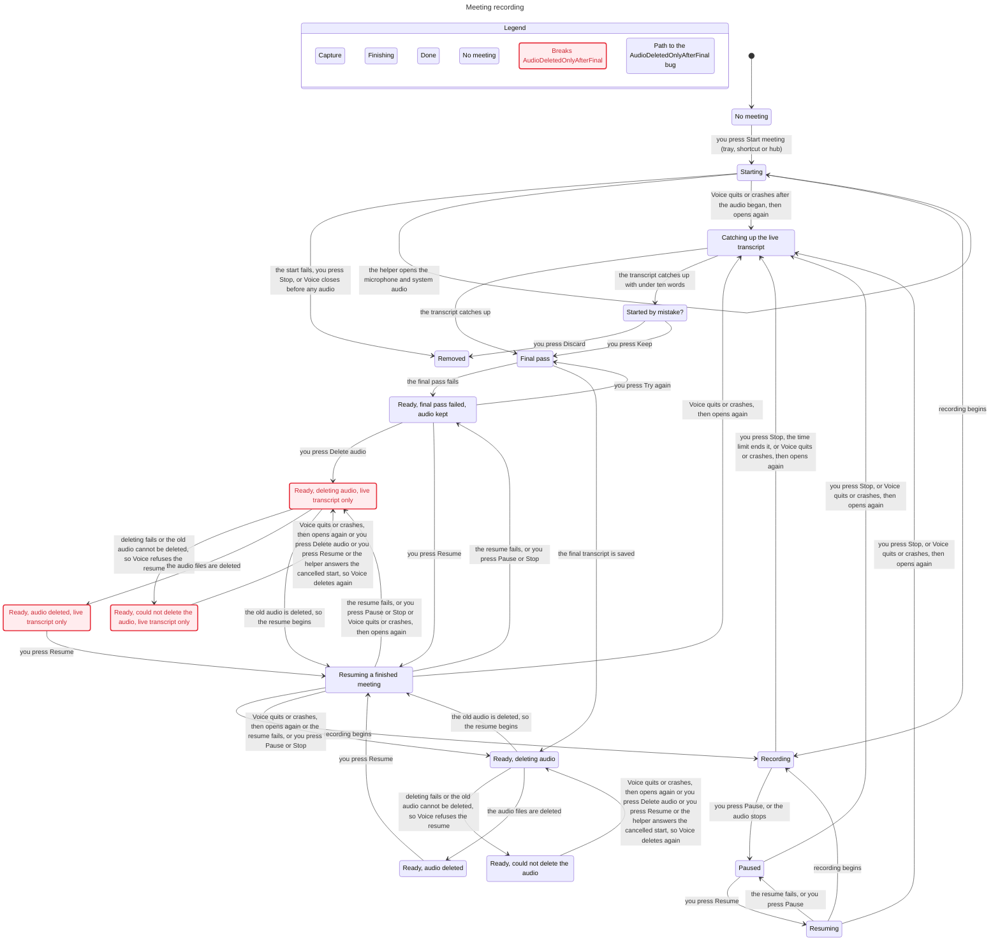

# Meeting recording

This chart follows one meeting from Start meeting (the tray item, the meeting shortcut or the hub's button) to its final transcript. It covers recording the microphone and system audio, pause and resume, Stop or the time limit, the live transcript catching up, `Started by mistake?`, the final pass, deleting the audio, resuming a finished meeting, and a quit or crash at any point followed by the next launch. [The Meetings feature map](../features/meetings.md) says how to drive each step.

## Rules

- `RecordsOnlyWhenAsked` holds. The helper records only after you press Start meeting or Resume, and not after you stop or pause. A relaunch never records. It finishes an unfinished meeting from its files and sends no `meeting.start`.
- `TrayStopExactlyWhileLive` holds. The tray item reads "Stop meeting" exactly while a meeting is recording or paused. It also reads "Stop meeting" while paused, because Stop then ends the paused meeting (`meetingToggle` in `shared/meetings.ts`). While a meeting starts or resumes, it reads "Starting meeting…" and does nothing.
- `TrayNeverOffersStartWhileRecording` holds. While the helper records, the tray never offers Start meeting.
- `RecordingMeansCapturing` holds. A meeting reads Recording only while the helper records.
- `AudioDeletedOnlyAfterFinal` breaks, by design. Audio starts going only after its final transcript is saved, except when you press Delete audio on the "final pass failed" notice. That keeps the live transcript only.
- `VoiceKeepsUnfinishedAudio` holds. A quit, a crash, a relaunch or a failure never throws away audio that has no final transcript. Voice deletes such audio only after you press Delete audio, or after you end a resume of a finished meeting before it records. Each of those saves `deleting`, so a relaunch that finishes the delete finishes your request.
- `AudioGoneOnceFinal` holds. Once the final transcript is saved, any audio file still on disk is being deleted, or the next launch deletes it.
- `EndedResumeDeletesItsFiles` holds. A resume of a finished meeting that ends before it records deletes the files that its start made, unless they hold audio kept for Try again (#456).
- `NoStaleAppend` holds. A resume never adds to audio that already has its final transcript, unless the final pass failed and the audio is kept for Try again.
- `PartialAudioIsOnlyDeleted` holds. Audio that a failed delete left part of is `deleting`, so Voice only deletes it.
- `NoFinalPassOnPartialAudio` holds. No final pass runs over audio that a failed delete left part of, also after a quit while Resume deletes it (#451).
- `RecordsOnlyIntoPresentAudio` holds. The helper records only while `meeting.json` says the audio is `present`.
- `ReadyPresentOnlyForRetry` holds. A finished meeting keeps `present` audio only after a failed final pass, for Try again.
- `FilesOnlyWhenPresent` holds. Audio files are on disk only while the audio is `present` or `deleting`, or while a delete runs.
- `RecoveryIdempotent` holds. Recovery run twice ends where recovery run once ends. A recovery whose delete fails or is cut off ends there on the next launch.
- No state is a dead end. Every state has a way out, or is a finished or removed meeting. TLC's deadlock check proves it, so it has no rule in `meetings.cfg`.

## The `AudioDeletedOnlyAfterFinal` break

0. No meeting
1. you press Start meeting (tray, shortcut or hub): Starting
2. the helper opens the microphone and system audio: Starting
3. Voice quits or crashes after the audio began, then opens again: Catching up the live transcript
4. the transcript catches up: Final pass
5. the final pass fails: Ready, final pass failed, audio kept
6. you press Delete audio: Ready, deleting audio, live transcript only

The notice offers Try again and Delete audio. Delete audio saves `meeting.json` with `finalPassFailed: null` and `audio: { kind: "deleting" }` in one write. It then removes `mic.pcm`, `system.pcm`, `output.ndjson` and `audio.json`, saves `gone`, and keeps the live transcript. `meeting-recorder.test.ts` checks this in "a failed final pass can be tried again, or its audio deleted, after a relaunch too".

If `rm` throws, the audio stays `deleting`, and the command is refused with "The audio could not be deleted. Try again." The notice says Voice could not delete the audio and offers Delete audio only. Try again never comes back, because the audio is no longer `present`. The chart shows this as "Ready, could not delete the audio, live transcript only". The failed delete can be partial. It can remove `system.pcm` and keep `mic.pcm`. That changes nothing, because audio that is `deleting` is never transcribed or recorded onto. Resume finishes the delete first, and the next launch finishes it too. `meeting-recorder.test.ts` checks this in "Delete audio whose delete fails is refused, says so, and offers only Delete audio until it works", "after a partial Delete audio, Try again refuses and Resume deletes the rest before it records", "a relaunch finishes a Delete audio that failed part way, and runs no final pass" and "a relaunch whose delete fails again says so, and running recovery twice changes nothing more".

## The audio field

`meeting.json` saves the meeting's audio as one field: `present`, `deleting` or `gone`. Every delete saves `deleting` before it removes the first file, in the same write as the status change that asks for it. It then removes every audio file and saves `gone`. A delete that fails or is cut off by a quit leaves `deleting`, never `present`.

On `finalized`, main saves the final transcript, `ready` (or `summarizing` first when summaries are on), `finalPassFailed: null` and `deleting` in one write, and then it deletes the audio files. The chart shows this as "Ready, deleting audio". If `rm` throws, the chart shows "Ready, could not delete the audio". `meeting-recorder.test.ts` checks this in "stop transcribes the tail, asks for the final pass while the audio exists, then deletes the audio".

Resume on a finished meeting whose audio is `deleting` finishes the delete before it dispatches the resume (`finishDelete` in `meeting-recorder.ts`). If the delete throws, Resume is refused with "Voice could not clear this meeting's old audio. Try again." Nothing was saved, so the meeting stays `ready` and nothing records. Once the delete ends, the new leg starts new files with a fresh `audio.json`. `meeting-recorder.test.ts` checks this in "a resume after the audio delete failed starts new files instead of adding to the old ones" and "a resume whose leftover audio cannot be deleted does not record, and a later resume does". If Voice quits or crashes during that delete, the next launch deletes the audio. It never finishes that audio as a new leg, so no final pass runs over it (#451). `meeting-recorder.test.ts` checks this in "a relaunch after Voice quit while a resume cleared leftover audio does not transcribe that audio".

A resume that never records leaves files too. Resume on a finished meeting whose audio is gone saves `present` and writes a new `audio.json`, and the helper makes `mic.pcm` before it opens the microphone. That resume ends before it records when the start fails or times out, when the helper exits, and when you press Pause or Stop. The meeting then goes back to `ready`, saves `deleting` and deletes those files (`resumeEnded` in `meeting-lifecycle.ts`). Audio kept for Try again stays, and so does the audio of a paused meeting. `meeting-recorder.test.ts` checks this in "a resume that fails to start leaves the finished meeting without audio files" and "a resume that fails to start keeps the audio a failed final pass kept" (#456).

The helper can make files after that delete, because it makes `system.pcm` only after the microphone opens. So while a `meeting.start` is unanswered, the delete removes the files but does not save `gone`. The helper always answers a start with `meeting.started` or `meeting.failed`, or exits. Each answer runs the delete again, and that delete saves `gone`. The chart keeps the meeting in "Ready, deleting audio" until then. `meeting-recorder.test.ts` checks this in "a resume stopped before it records leaves no audio files, also when the helper opens the devices late" and "a resume stopped before it records ends gone even when the helper fails after opening a file late".

A Resume pressed in that moment is refused with "Voice could not clear this meeting's old audio. Try again.", because the audio is still `deleting`. Nothing failed, and Resume works once the helper answers. No watchdog bounds that wait, because the start watchdog ends with the resume. No test in the repository checks this refusal.

On the next launch, `recover()` finishes each unfinished meeting from its files. It then sends `audioFound` to each meeting whose audio is `deleting`, and to each meeting whose audio is `gone` but whose folder still holds an audio file. An empty file counts, and so does an `audio.json` alone. Each of those meetings deletes its audio again, unless a failed final pass keeps it `present`. Running the delete again changes nothing once the files are gone. `meeting-recorder.test.ts` checks this in the tests whose names start with "a relaunch deletes the audio of", in "a relaunch after the audio was deleted but meeting.json could not say so saves gone and says nothing", in "a relaunch deletes the empty audio files a resume that never recorded left on a finished meeting", and in "a relaunch after Voice quit while a finished meeting resumed leaves no audio files".

## What the model leaves out

- The summary and the title after the final pass, and resuming a meeting while it writes its summary.
- Deleting a meeting from the list, retention expiry, and Discard sent by the API outside `Started by mistake?`.
- The silence prompt. Its 30 s stop is part of "the time limit ends it".
- A meeting that records the microphone only, because system audio is denied or unavailable.
- The echo gate and the voice detector. They decide which words reach the transcript, not which state the meeting is in. The `vv meeting` fixtures check them.
- The helper exit count. A drain or a final pass that loses the helper twice moves on or fails.
- A `meeting.started` that arrives after you paused. Main answers with `meeting.stop`. The model leaves out the audio the helper appends until then.
- A `meeting.json` write that fails. The model saves every write. In the code, a write that must land first (the start of a leg, and the `deleting` write before a delete, except the one that ends a resume) refuses the step. A `gone` write that fails is finished by the next launch.
- Meetings saved by older builds. They get the audio field once, at load, from their status and files. `meetings-store.test.ts` checks this in "a meeting saved before audio was a field reads it once from its status and files".
- One flag stands for every unanswered `meeting.start`. A helper exit answers it at once. The model lets that answer come as its own step.
- The model lets a delete fail even when no file is left.
- Resume pressed while a delete runs. The code waits for that delete. The model lets you press Resume only after it ends.
- The moment between Resume and the new `audio.json`. The model writes that file in the Resume step, and the `startCapture` effect writes it moments later.
- A start watchdog that fires while the helper already writes audio. The meeting is removed with its folder.
- Power loss. The helper syncs the files every 5 s, so the last seconds can go.
- Dictation markers, the notepad, the Flow Bar, and a second meeting. Only one meeting can be live.
- The model treats a quit, the next launch and `recover()` as one step. Start, Resume and the toggle wait behind `recover()`.

## What the chart hides

- A quit or crash in `Started by mistake?` or in Final pass. Both lead to "Catching up the live transcript", as from Paused.

The chart does not draw steps that stay in one state. These are:

- A quit or crash while catching up. It stays in "Catching up the live transcript".
- A quit or crash while deleting the audio. The next launch deletes it again.
- A delete that ends while a cancelled start is unanswered, and a Resume refused for that reason. Both stay in "Ready, deleting audio".
- The helper answering a cancelled start on a paused meeting, or on audio kept for Try again. The audio stays, and main stops a capture that started.

## Regenerate

Run the sync check in [README.md](README.md#keep-the-charts-true).
