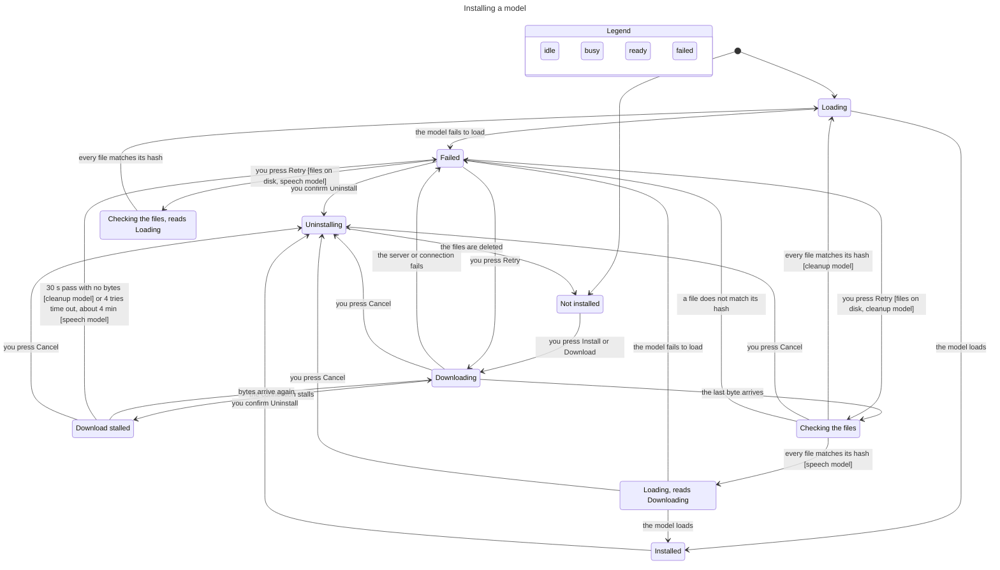

# Model install

This chart follows one model row, Parakeet (the speech model) or S1-mini (the cleanup model), as it appears in Settings > Models and on Home's `Set up Voice` checklist. It covers install, download, a stalled or failed download, the hash check, loading, and uninstall. [The Models feature map](../features/models.md) says how to drive each step.

## Rules

- `ReadyMeansComplete` holds. The row reads "Installed" only when every file is on disk with the right bytes.
- `WayOut` holds. A stalled or failed download always offers Retry or Cancel. Both rows show Cancel while they download, stalled or not.
- `UninstallClears` holds. After you confirm Uninstall or press Cancel, the files are gone, the row reads "Not installed", and dictation no longer uses the model.
- `NoPartialUse` holds. Dictation never uses a partial download.
- `StallEnds` holds. A stall never keeps the row in "Downloading" for good, because each download gives up on its own. S1-mini gives up after 30 s with no bytes. Parakeet gives up after 4 tries that each hit URLSession's 60 s idle timeout, about 4 minutes. Then the row shows the failure message and Retry.

To verify, check that `modelView` and `checklist` give `Cancel` to a row in `downloading`, speech and cleanup alike. Cancel on the speech row goes straight to "Not installed", with no "Failed" in between. `ModelFetcherTests.aConnectionBelowTheMinimumRateCountsAsTimedOut` checks the 4 tries.

## What dictation does while a model is not ready

The chart has no dictation step. With the speech model missing or failed, a dictation fails at once with "Set up the speech model in Voice first". While the speech model downloads, including the hash check and load after the last byte, it fails with "The speech model is still downloading". While it loads at launch or on a Retry with every file on disk, Voice records, and the transcript waits for the load to finish. With the cleanup model in any state but loaded, Voice inserts the raw transcript.

## What the model leaves out

- The Transform model on the same page.
- Cleanup turned off. The S1-mini row then reads "Installed. Loads when text cleanup is on." in place of "Installed", and Home hides the row.
- The first instant after launch, when every row reads "Not installed" before the check of the disk finishes.
- Uninstall refused while a dictation runs. The speech row disables Uninstall then.
- A failed delete during uninstall, and an S1-mini engine that stops after it has loaded and reloads.
- The few milliseconds between the files going and the row reading "Not installed". The model treats them as one step.
- Files damaged or deleted outside Voice.

## What the chart hides

Nothing. Every step has an arrow. "Checking the files" and "Loading, reads Downloading" both read "Downloading" and offer Cancel. Cancel there deletes the model even when every file is on disk, such as the S1-mini file that you retry after a load failure or the Parakeet folder after its last byte.

## Regenerate

Run the sync check in [README.md](README.md#keep-the-charts-true).
