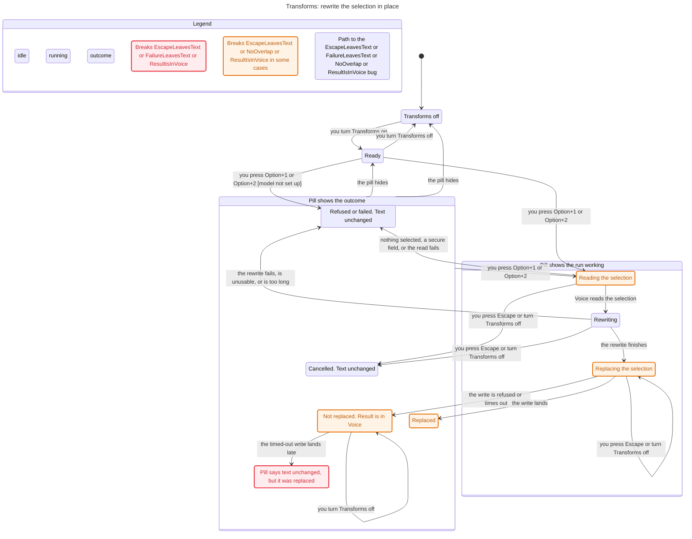

# Transforms run

This chart follows one Transforms run, from the shortcut to the outcome the Flow Bar pill shows. It covers the Transforms switch, Escape, the refusals, a failed rewrite, a refused or timed-out write, and the clipboard that the copy read and the paste borrow. [The Transforms feature map](../features/transforms.md) says how to drive each step.

## Rules

- `OnlyFinishedRewrite` holds. The selection only ever holds your text or a finished rewrite. The engine's guard rejects an empty or cut-off answer, and the helper writes the whole result in one insert.
- `FailureLeavesText` breaks. When the pill says the text was left alone (cancelled, refused, failed, or "Not replaced. Result is in Voice"), the text is unchanged.
- `ClipboardComesBack` holds. Once the helper has no Cmd+C or paste in flight, the clipboard holds your contents. A read cancelled during its Cmd+C still puts them back.
- `DoneMeansReplaced` holds. The pill shows the inserted outcome only after the helper reports the write.
- `NoOverlap` breaks. While a run works, no earlier run can still write to the text. A second press during a run is dropped, so only the timed-out write breaks it.
- `EscapeLeavesText` breaks. Escape during a run leaves the text unchanged.
- `ResultIsInVoice` breaks. When the pill says "Result is in Voice", the Last transform panel holds this run's result.

"Pill says text unchanged, but it was replaced" breaks `FailureLeavesText`, and in some cases also `EscapeLeavesText` and `ResultIsInVoice`. "Reading the selection" breaks `NoOverlap` in some cases. "Replacing the selection" and "Replaced" break `EscapeLeavesText` in some cases. "Not replaced. Result is in Voice" breaks `ResultIsInVoice` in some cases.

## The timed-out write (`FailureLeavesText`, `NoOverlap`)

0. Transforms off
1. you turn Transforms on: Ready
2. you press Option+1 or Option+2: Reading the selection
3. Voice reads the selection: Rewriting
4. the rewrite finishes: Replacing the selection
5. the write is refused or times out: Not replaced. Result is in Voice
6. the timed-out write lands late: Pill says text unchanged, but it was replaced

For `NoOverlap`, step 6 is "you press Option+1 or Option+2: Reading the selection".

Main gives the helper 5 s (`INSERT_TIMEOUT_MS`) to answer an insert. Then it ends the run as not inserted and sends `transform.end`. In the helper, `transform.end` clears the shelf and cancels only a read, so a write that `Insertion.insert` already holds goes on. Main drops its late `insert.result`. The text changes under a pill that says "Not replaced", and a new press can start a run before that write lands. It needs a write slower than 5 s, for example in an app that answers each accessibility call only at its 0.3 s timeout. That is a guess, not measured.

To verify, drive `createTransforms` with an insert that does not answer, advance 5 s, and send the late `insert.result`. The outcome stays `notInserted`, and a press sends a second `selection.read` while the first insert is unanswered.

## Escape during the write (`EscapeLeavesText`)

Steps 0 to 4 as above, then:

5. you press Escape or turn Transforms off: Replacing the selection
6. the write lands: Replaced

`step()` honors cancel only while reading or generating. The test "Escape once the write started changes nothing" pins this, so the code means it. The Transforms recipe says the same. The pill looks the same in all three running states, so you cannot see when Escape stops working.

## Transforms off and Last transform (`ResultIsInVoice`)

Steps 0 to 5 as in the timed-out write, then:

6. you turn Transforms off: Not replaced. Result is in Voice

Turning Transforms off clears Last transform at once, but the pill keeps "Result is in Voice" until it hides 2.5 s later. A second path turns Transforms off during "Replacing the selection". Main ignores the cancel there, clears the panel, and a refused write then shows "Result is in Voice" over an empty panel.

## What the model leaves out

- Model loading. "Rewriting" includes the "Loading model" pill, and the rewrite timeout starts only once the model is ready.
- Dictation. A shortcut is dropped while a dictation runs, and a dictation that starts hides the outcome pill.
- The shortcut disarm while the Voice window has focus, the editor, After dictation, and the log line.
- A helper crash. Main fails the run with "Voice helper stopped", and a paste restore that had not run is lost with the process.
- A clipboard that someone else changes during a copy or a paste. The helper then leaves it alone.
- A clipboard that holds a concealed item such as a password. The helper clears it rather than restoring it, by design.
- A target that answers the Cmd+C after the 1 s late check. Its answer stays on the clipboard.
- A target that reads the paste after the 1 s restore and pastes your old clipboard. The model counts a posted paste as a replacement.
- Time. Each wait is one step, so the model does not know that the 1.3 s pill outlasts the 1 s paste restore.
- The helper's 50 ms re-read after an accessibility write that seems to change nothing. A write is one step.
- More than two runs.

## What the chart hides

- Steps that stay in one state. These are the helper's Cmd+C and its answer inside "Reading the selection", the paste restore, a second press during a run, and an answer for a run that is over.
- "you press Option+1 or Option+2 [model not set up]" from an outcome. It repeats the arrow from Ready.
- Every arrow into "Pill says text unchanged, but it was replaced" except the one from "Not replaced. Result is in Voice". The others come from the same late write landing during a later run or under another outcome.
- The exact pill text. "Refused or failed. Text unchanged" stands for "Select text first", "Can't read a secure field", "Click into the text first", "Release the keys, then try again", "Too long. Select up to N words", the model messages, and the failure messages. "Not replaced. Result is in Voice" stands for five write refusals.

## Regenerate

Run the sync check in [README.md](README.md#keep-the-charts-true).
